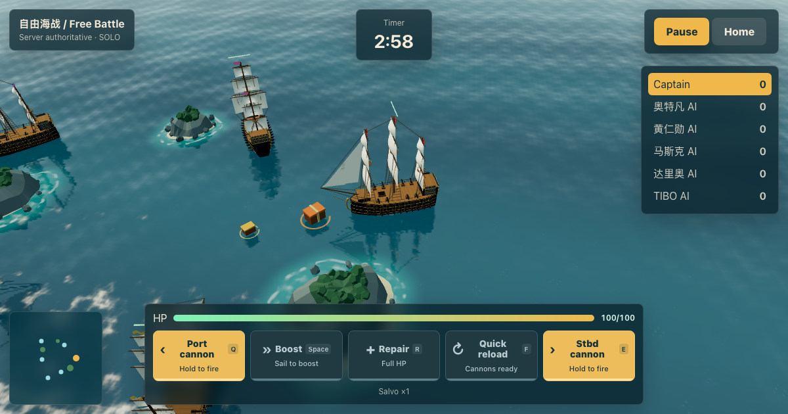

# Stormbreakers — Set Sail. Open Fire. Take the Treasure.

**A free, open-source 3D naval battle browser game.** Sail, fire broadsides, survive moving waterspouts, and compete for treasure in three-minute rounds. Play against AI or invite friends into a room for up to six players.

**[Play online →](https://stormbreakers.onrender.com/)** · **[English game →](https://stormbreakers.onrender.com/en/)** · [中文说明](README.zh-CN.md) · [Report a bug](https://github.com/aotefan/stormbreakers/issues)

[](https://github.com/aotefan/stormbreakers/actions/workflows/ci.yml)
[](LICENSE)



## Play

Open **https://stormbreakers.onrender.com/** in a modern browser with JavaScript and WebGL enabled. No installation or account is required. Choose AI Practice, or Create Room and share the five-character code with friends. Vacant seats are controlled by AI. On a sleeping Render free instance, the first visit may take longer to load.

| Mode | Objective |
| --- | --- |
| Free Battle | Manoeuvre and sink opponents with port and starboard cannons. |
| Storm Survival | Avoid moving waterspouts and earn survival points. |
| Treasure Raid | Collect more valuable crates while fighting other ships. |

- Easy, normal and hard AI. Five AI captains: 奥特凡, 黄仁勋, 马斯克, 达里奥 and TIBO.
- Keyboard and touch controls, English and Simplified Chinese interfaces, adjustable graphics and sound.
- Player-only weapon crates: three power tiers, up to five explosive projectiles per salvo. Power lasts 15 seconds; further pickups refresh it.
- Visible hull breaches, torn sails, repairs, sinking and respawn.
- Shared room rematches. Solo pause freezes the game; online rounds continue while menus are open.

| Action | Keyboard | Touch |
| --- | --- | --- |
| Sail | WASD | Drag your ship; release to stop |
| Fire port / starboard | Hold Q / E | Hold the cannon button or a second finger on either side of the sea |
| Boost | Space | Boost button |
| Repair | R | Repair button |
| Instant reload | F | Reload button |

## Run locally

Use the latest security-patched Node.js 24 LTS. The checked-in baseline is **24.22.1**, verified against the [October 21, 2026 security release](https://nodejs.org/en/blog/vulnerability/october-2026-security-releases). Recheck official advisories before future deployments.

```bash
git clone https://github.com/aotefan/stormbreakers.git
cd stormbreakers
nvm install
nvm use
node --version
npm ci
npm run build
npm start
```

Open **http://localhost:8787**. `nvm` is optional; any installation of the required Node version works. For development, run `npm run dev` and visit **http://localhost:5173**. Vite serves the UI and the Node server handles WebSocket sessions on port 8787.

## Architecture

| Path | Responsibility |
| --- | --- |
| `src/ui/` | React menus, HUD and input controls |
| `src/three/` | Procedural ships, ocean, islands, weather and damage rendering |
| `src/game/` | Solo simulation, network session, movement prediction and audio |
| `shared/` | Simulation, AI, abilities, weapons and message types |
| `server/` | HTTP static hosting, input validation and authoritative WebSocket rooms |
| `src/site.ts`, `scripts/prerender.tsx` | Shared visible site facts and prerendered Chinese/English pages |
| `public/` | Favicon, social image, robots.txt, sitemap.xml and supplementary llms.txt |
| `scripts/` | Rules, networking, browser and security regression checks |

Online simulation runs at 20 Hz; the browser renders and predicts local movement between snapshots. Room state is held in memory. There are no accounts, database, analytics SDK or persistent saves. Restarting the service clears online state; empty rooms expire after one minute. Ships, textures, scenery and audio are generated in code. Third-party packages retain their own licenses; see [THIRD_PARTY_NOTICES.md](THIRD_PARTY_NOTICES.md).

## Deploy to Render

This is a Node Web Service, not a static-only site: multiplayer needs a long-running WebSocket server.

1. Fork this repository and create a Render Blueprint using `render.yaml`, or create a Node Web Service manually.
2. Set **Node 24.22.1 or a newer security-patched 24.x version** in the service environment. Existing services may need their `NODE_VERSION` updated in the dashboard; editing YAML alone does not update a manually configured service.
3. Build: `npm ci --include=dev && npm run build`. Start: `npm start`. Health check: `/healthz`. Set `NODE_ENV=production`.
4. The service binds `0.0.0.0:$PORT`, serves the website, and accepts `/ws`. HTTPS pages use WSS automatically.
5. Confirm the deployment logs and `/healthz` response header `X-Runtime-Version` show the intended runtime. `X-Revision` identifies the deployed commit when Render supplies `RENDER_GIT_COMMIT`.

For a fork or custom domain, update `SITE_URL` and `REPOSITORY_URL` in `src/site.ts`, the URLs in `public/{robots.txt,sitemap.xml,llms.txt}`, `package.json`, and these README files before building. The documented public demo remains **https://stormbreakers.onrender.com/**.

The free tier may sleep, cold-start or restart. State is ephemeral. The current implementation is single-process; multiple replicas need shared room coordination. Payload, connection, room and per-socket message limits are basic safeguards, not a distributed abuse-prevention service.

## Test

```bash
npm ci
npx playwright install chromium
npm test
npm audit
```

On Linux CI use `npx playwright install --with-deps chromium`. `npm test` builds and runs AI, weapons, supplies, abilities, damage, touch, room state/rematch, malformed-input/HTTP, prerender/SEO, desktop and touch-browser checks. Browser scripts launch their own servers on ports 8791–8798. Touch coverage uses Chromium emulation; it does not establish physical iPhone/iPad compatibility. Optional headed playthrough scripts require installed Google Chrome.

## Discoverability

Both `/` and `/en/` contain visible game descriptions, controls and FAQs in the initial HTML. They have self-canonical URLs, reciprocal language alternatives, Open Graph/Twitter previews and fact-based VideoGame/SoftwareSourceCode JSON-LD. Unknown URLs return 404 rather than duplicate homepages. [Search maintenance notes](docs/search.md) cover sitemap submission and limitations. `llms.txt` is a supplementary summary; search ranking or inclusion in AI answers is not guaranteed.

## Contribute and license

See [CONTRIBUTING.md](CONTRIBUTING.md) for development and pull requests, and [SECURITY.md](SECURITY.md) for private vulnerability reporting. Licensed under [MIT](LICENSE).
